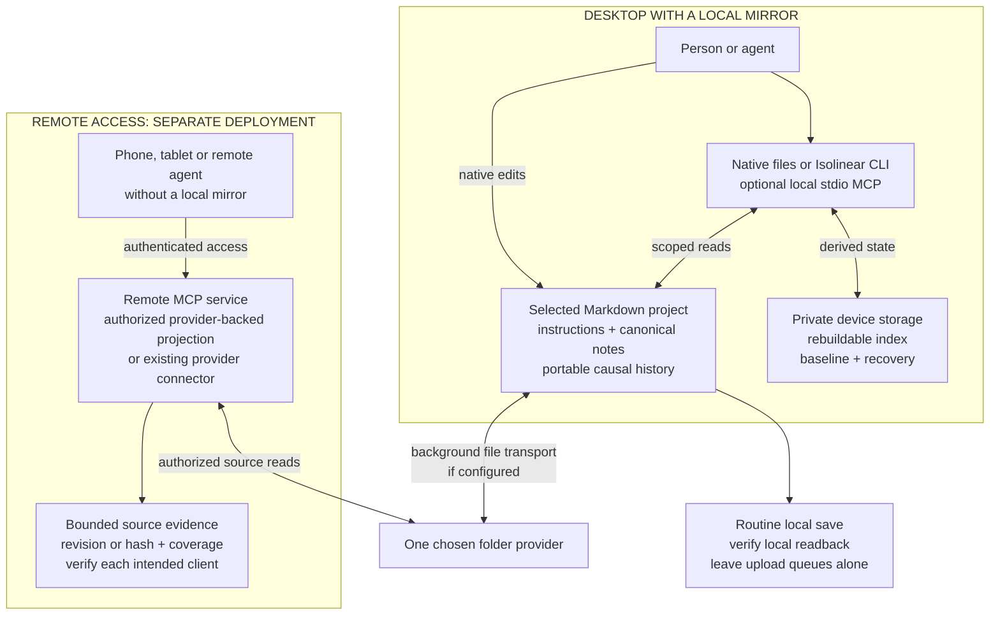
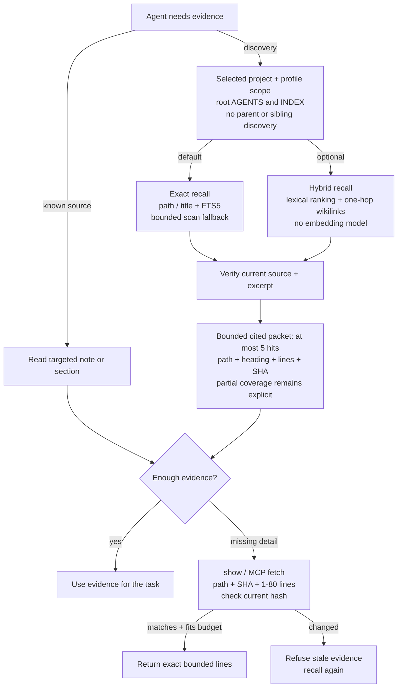
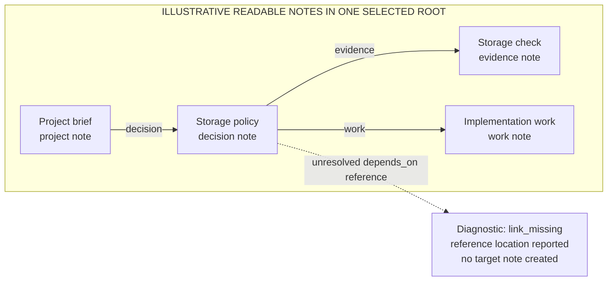
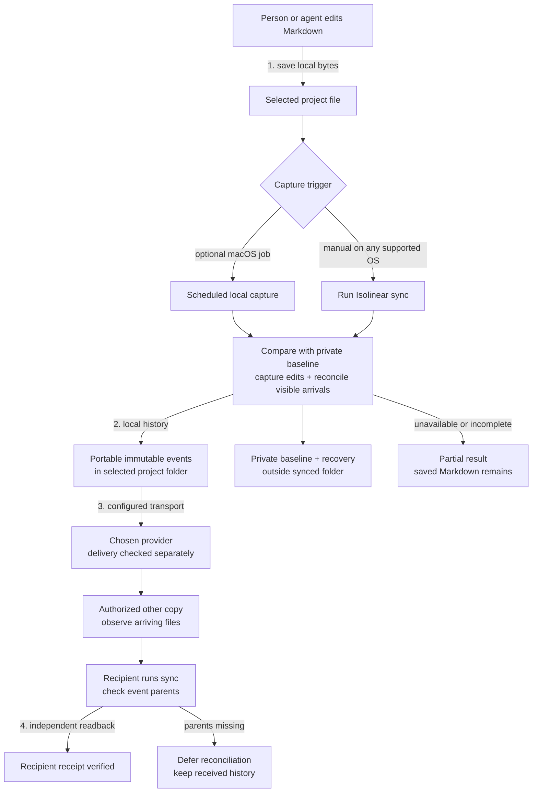
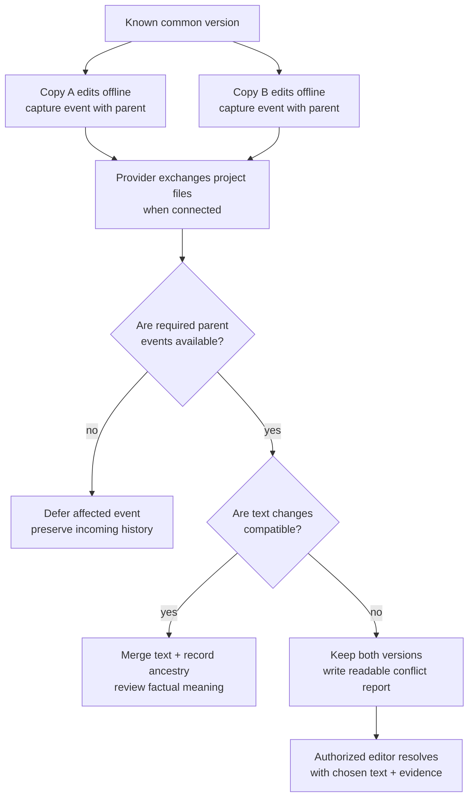
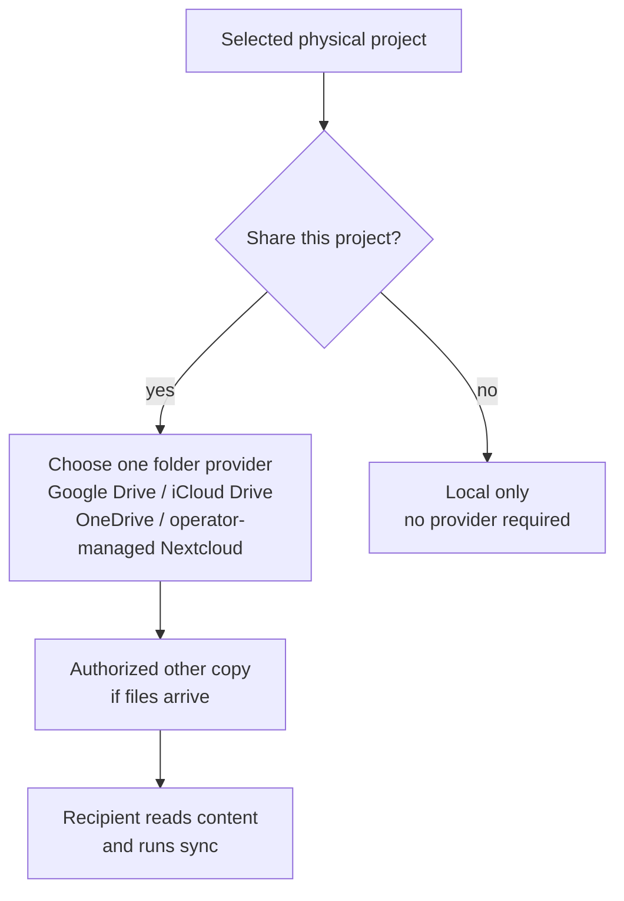

# Isolinear Memory

<p align="center">
<picture>
  <source media="(prefers-color-scheme: dark)" srcset="assets/isolinear-memory-dark.png">
  
</picture>
</p>

**Persistent Markdown memory for people and AI agents. Keep the originals. Retrieve the evidence a task needs.**

Isolinear Memory helps an agent pick up a project without replaying its entire
conversation history. Decisions, sources and current work live in ordinary notes.
The agent reads the relevant passages, does its work, and updates the existing
project record. A local runtime captures supported file changes and helps
reconcile the project copies that are visible on different devices.

The core works offline in one selected folder. Your editor, Obsidian, Git and
folder provider can remain part of your workflow. A hosted service, vector
database or memory-extraction model is optional architecture, not a requirement.

[Get started](#get-started) · [How it works](#how-it-works) ·
[Knowledge graph](#the-knowledge-graph) · [Devices and access](#devices-and-access) ·
[Documentation](#documentation)

## What it gives you

- **Durable project context:** authored instructions, an index and canonical notes
  that a new agent or chat can read.
- **Source-linked retrieval:** bounded passages with a path, line range and source
  hash, plus explicit warnings about incomplete coverage.
- **Recoverable history:** portable causal events and private device recovery state
  for supported captured changes, including visible conflict handling.
- **Optional context tools:** complete authored bootstrap packets, receipts for
  evidence still retained by the caller, and a read-only local MCP adapter.

The runtime records files. The agent decides what useful knowledge to write.
It does not automatically turn every conversation into facts or silently replace
original notes with generated summaries.

## Get started

Isolinear Memory **0.7.1** requires Python **3.11+**. The runtime supports macOS,
Linux and Windows. POSIX command launchers are supplied for macOS/Linux; Windows
can invoke the verified `.pyz` with Python. Automatic capture installation is
supplied for macOS; other systems can use manual capture or their own scheduler.

### With an agent

1. Select the exact folder that should hold the memory. Keep personal, company and
   unrelated project scopes separate.
2. Give an agent with authorized file access the [setup prompt](SETUP-PROMPT.md).
   It follows the [installation guide](docs/INSTALL.md), verifies release checksums,
   and preserves an existing project's identity, notes and history.
3. Choose a profile for a new empty folder. Populated folders keep their layout.
4. Confirm the installed version and a real local capture result. Routine saves
   complete with local-file readback; leave cloud upload queues alone.

| New folder profile | Starting layout | Intended use |
| --- | --- | --- |
| Team | `Raw/`, `Wiki/`, `Output/` | Shared organizational knowledge and sources |
| Personal | `Notes/`, `Resources/` | Concise personal notes without manual team registers |
| Project | Domain folders you choose | A software, research, production or other bounded project |

### Manual installation

Download the runtime and external `SHA256SUMS` from the
[0.7.1 release](https://github.com/Kian-hdr/isolinear-memory/releases/tag/v0.7.1).
Verify the downloaded runtime before executing it, then follow the
[installation instructions](docs/INSTALL.md). Keep the prior package for rollback.

After installing the command, a new empty personal folder can be initialized with:

```bash
isolinear-memory setup "/path/to/selected-folder" --vault-type personal
```

Use a real selected path. For an existing project, resume its binding and profile;
do not initialize another identity or reorganize its files. Setup does not create
cloud accounts, grant sharing access or configure a phone backend.

## How it works

There are four places to distinguish:

| Place | What belongs there |
| --- | --- |
| Selected project folder | Authored Markdown, routing files, project identity and portable history |
| Private storage on each device | Rebuildable search index, causal baseline and recovery state |
| Folder provider, if configured | Transport of the chosen project files to authorized copies |
| Agent context | The current task, relevant instructions and selected source evidence |

<!-- BEGIN GENERATED MERMAID: 01-shared-folder.mmd -->

<!-- END GENERATED MERMAID: 01-shared-folder.mmd -->

The selected folder is the authority for its authored knowledge. A private search
index helps find passages; it can be rebuilt. The provider transports files, while
the agent receives bounded evidence. Each authorized desktop copy needs its own
private device state. Local-only use needs no folder provider.

### A typical work session

1. Read `AGENTS.md`, `INDEX.md` and the relevant current handoff.
2. Use a native read for a known note, or search when its location is unknown.
3. Expand evidence when the returned excerpt leaves a fact or qualification missing.
4. Complete the work and update the existing canonical note with durable results,
   sources, open work and next steps. Read the saved file back.
5. Let configured local capture run in the background, or run one bounded manual
   `sync` when automatic capture is not available.

A fresh chat can resume from that authored handoff. Shared files do not transfer
an agent's live conversation context by themselves.

## Retrieve evidence without loading the whole vault

`recall` returns small source-linked hits. Its default limit is five hits and a
2 KiB response budget. Each hit identifies the source path, heading, exact lines,
excerpt and SHA-256 hash. Coverage fields report unavailable, truncated or
unsearched material. A no-hit or partial result is not proof that a fact is absent.

```bash
isolinear-memory recall . "project owner" --max-hits 3 --text
isolinear-memory recall . "delivery constraints" --strategy hybrid --text
```

Use `.` only from inside the intended project. Exact recall is the default.
Optional hybrid recall combines lexical matches, titles and a bounded subset of
explicit note links. It requires no embedding model. The configured profile
controls retrieval folders: team defaults to `Wiki/`, personal to `Notes/`, and
projects to their declared domain folders, alongside the root routing files.
See [retrieval scope](docs/PRODUCT-V1.md#optional-hybrid-retrieval) for opt-in sources
and coverage limits.

<!-- BEGIN GENERATED MERMAID: 05-recall-and-index.mmd -->

<!-- END GENERATED MERMAID: 05-recall-and-index.mmd -->

Candidates are checked against current local source bytes before evidence is
returned. Warm indexed search can still leave new or changed paths unsearched.
Use a targeted native read or deliberate `--refresh` when current coverage is
needed; refresh may encounter a slow or unavailable cloud-backed file.

When an excerpt is insufficient, use `show` with the returned path and hash:

```bash
isolinear-memory show . --path "Wiki/Project Brief.md" \
  --sha256 HASH_FROM_RECALL --start 1 --end 20 --text
```

Substitute the actual source path, hash and needed line bounds. `show` returns up
to 80 exact lines per request and refuses a changed source. A search excerpt that
already contains all required facts and qualifiers can be sufficient; a heading-only
hit still needs expansion. Fetching the same evidence twice adds context cost.

### Bootstrap packets and retained evidence

`context-packet` reads complete `AGENTS.md`, complete `INDEX.md` and one explicitly
selected canonical note or unique Markdown heading, including its subsections:

```bash
isolinear-memory context-packet . --path "Wiki/Project Brief.md" \
  --heading "Current handoff" --max-bytes 8192
```

All required sources must fit. Missing, unsafe, ambiguous or over-budget input
returns no partial packet. The tool does not decide which handoff is important,
summarize its contents or silently trim a stop condition.

Optional evidence receipts let a caller omit an exact passage it still retains,
after source revalidation. They are local-context identifiers, not a replacement
for the text. Discard them after reset, compaction or uncertain retention and
request the evidence again. Short or one-off passages can cost more with receipts.
See [context packets](docs/PROGRESSIVE-CONTEXT.md) and
[evidence receipts](docs/EVIDENCE-RECEIPTS.md).

An MCP server cannot remove old messages from a host's context. Smaller future
responses and an external index help control what gets loaded next; the host still
owns conversation compaction and context-window behavior.

## The knowledge graph

A knowledge graph maps **explicit references between documents**. For example, a
project brief can link a decision to its supporting evidence and implementation
work. Isolinear reports the links, backlinks and unresolved targets so an agent can
follow the right sources or inspect reference health.

<!-- BEGIN GENERATED MERMAID: 06-knowledge-graph.mmd -->

<!-- END GENERATED MERMAID: 06-knowledge-graph.mmd -->

```bash
isolinear-memory graph .
```

The command returns JSON with nodes, edges, backlinks, source locations and
diagnostics. It reads a bounded selected folder tree and does not change notes,
rewrite links, infer semantic relationships or decide whether a statement is true.
Its graph-inspection scope is documented separately from `recall`'s profile scope.
Keep reports private when their note names or links are private; inspect the needed
summary or edges instead of loading a whole graph into model context.

For a project with `Decisions/` and `Evidence/` folders, two supported
ways to write an explicit relationship are:

```markdown
[Supporting evidence](../Evidence/Storage%20Check.md)
[[Decisions/Storage Policy]]
```

Link-bearing frontmatter such as `evidence: "[[Storage Check]]"` can also name a
relationship. Ambiguous, missing or unsafe targets are reported rather than
silently guessed. Supported syntax and limits are in the
[knowledge graph guide](docs/KNOWLEDGE-GRAPH.md).

There are **two different graphs** in the system. The knowledge graph connects
notes through their references. The history graph connects captured versions
through their parent events, helping reconcile offline changes. A link between
notes does not grant access, authenticate an author or prove factual agreement.

## Save history and handle offline edits

A normal save writes the Markdown file locally. `sync` compares observed files
with the private causal baseline, captures supported changes, and reconciles
complete history that is already visible in the selected project:

```bash
isolinear-memory sync . --brief
```

Configured macOS capture can do this outside the agent. A partial capture leaves
the saved Markdown in place and reports the gap. Capture is not a complete backup
of every attachment or a guarantee that a provider cannot overwrite uncaptured work.
Retain appropriate backups and provider history.

<!-- BEGIN GENERATED MERMAID: 02-edit-and-deliver.mmd -->

<!-- END GENERATED MERMAID: 02-edit-and-deliver.mmd -->

| Observation | What it establishes |
| --- | --- |
| Local readback | The intended file bytes are present on this device |
| Local capture | Isolinear recorded the observed supported version and history |
| Provider delivery | An explicitly checked transport delivered files |
| Recipient readback | The other device read the intended content and history |

Routine note work verifies local readback; local capture has its own status.
An explicit delivery test can check the latter two observations; ordinary note work does not inspect Drive/OneDrive apps,
upload queues or background syncing.

<details>
<summary>How offline versions and conflicts are preserved</summary>

<!-- BEGIN GENERATED MERMAID: 03-offline-and-conflicts.mmd -->

<!-- END GENERATED MERMAID: 03-offline-and-conflicts.mmd -->

Each captured event names its known parents. Once complete parent history arrives,
compatible text changes can merge. Missing parents defer reconciliation.
Overlapping edits preserve both versions and a readable conflict report for
resolution. Timestamps do not select the factual winner. Explicit `delete` and
`rename` operations record intent; a missing provider file is not a deletion.
Folder rename does not automatically rewrite backlinks.

</details>

## Devices and access

| Environment | Practical route |
| --- | --- |
| Desktop with a local mirror | Native files or CLI; optional fixed-project stdio MCP |
| Authorized remote computer with a mounted mirror | The same selected-folder workflow on that computer |
| Phone or tablet without a mirror | A separately deployed authenticated remote MCP service, or an authorized provider connector |

The released local MCP adapter exposes three read-only tools: search, exact fetch
and authored context. It is optional and uses a separately pinned SDK. It does not
create a public HTTP endpoint or stay reachable while its computer is asleep.
See [MCP setup](docs/MCP.md).

A remote service needs its own hosting, authentication, source permissions,
freshness checks and client acceptance. This public release does not provision
those accounts or include private deployment bindings. Test the actual client and
allowed corpus; a synthetic endpoint test does not establish real-note access.

For shared folder use, choose one provider per physical project. Authorized people
receive access through that provider and set up their own private device state.
Folder selection does not grant access. Google Drive, OneDrive, iCloud Drive and
operator-managed Nextcloud are alternative transports, not automatic bridges.

<details>
<summary>Local-only use and folder-provider choices</summary>

<!-- BEGIN GENERATED MERMAID: 04-provider-options.mmd -->

<!-- END GENERATED MERMAID: 04-provider-options.mmd -->

See [provider guidance](docs/PROVIDERS.md) for platform and delivery details.

</details>

## Privacy, compatibility and limits

- Private indexes contain derived passage text. Keep them, credentials and recovery
  material outside shared storage. Source filters are not a secret classifier.
- Portable history may retain text removed from current notes. Choose the correct
  sharing boundary and use backups appropriate to the records.
- Person/agent labels are asserted attribution, not authenticated identity.
- Original Markdown remains readable in other editors. Obsidian is optional; Git
  can continue to manage code and reviews independently.
- Existing format-3 projects keep `.shared-memory.json`, `.shared-memory/`, their
  identity and history. `shared-memory` and the older setup-skill name remain
  compatible entry points. Formats 1/2 retain their historical coordinator workflow
  until an explicit backed-up migration.
- Token savings depend on the task. JSON, hashes, receipts and discovery have
  overhead. [Measured fixtures](docs/CROSS-DEVICE-OPTIMIZATION.md) and
  [validation evidence](VALIDATION.md) distinguish reference tokens from total
  model usage, billing, answer quality and physical-device acceptance.

## Documentation

| Need | Guide |
| --- | --- |
| Give an agent a complete setup request | [Setup prompt](SETUP-PROMPT.md) |
| Install, update or roll back | [Installation](docs/INSTALL.md) |
| Use the commands and understand profiles | [Operating guide](docs/PRODUCT-V1.md) |
| Set up background local capture | [Automatic capture](docs/AUTOMATIC-CAPTURE.md) |
| Inspect links, backlinks and graph diagnostics | [Knowledge graph](docs/KNOWLEDGE-GRAPH.md) |
| View diagram sources and SVG fallbacks | [System diagrams](docs/DIAGRAMS.md) |
| Connect a local agent through MCP | [MCP guide](docs/MCP.md) |
| Understand context cost and selective adaptations | [Cross-device design](docs/CROSS-DEVICE-OPTIMIZATION.md), [research](docs/RESEARCH-CROSS-DEVICE.md) |
| Review what was tested | [Validation](VALIDATION.md), [benchmarks](benchmarks/README.md), [agent compatibility](docs/AGENT-COMPATIBILITY.md) |
| Work with retained coordinator projects | [Historical coordinator guide](docs/COORDINATOR-WORKFLOW.md) |

## Development and license

Build with `scripts/build_product.py`. Release assets come from an exact clean
committed revision through `scripts/build_release.py`; each release includes a
source manifest and external checksums. The [CI workflow](.github/workflows/test.yml)
covers macOS, Linux and Windows.

[MIT licensed](LICENSE). The name is inspired by
[Star Trek's isolinear chips](https://www.startrek.com/en-un/news/below-deck-with-lower-decks-403-move-along).
[Icon source and exports](assets/README.md).
